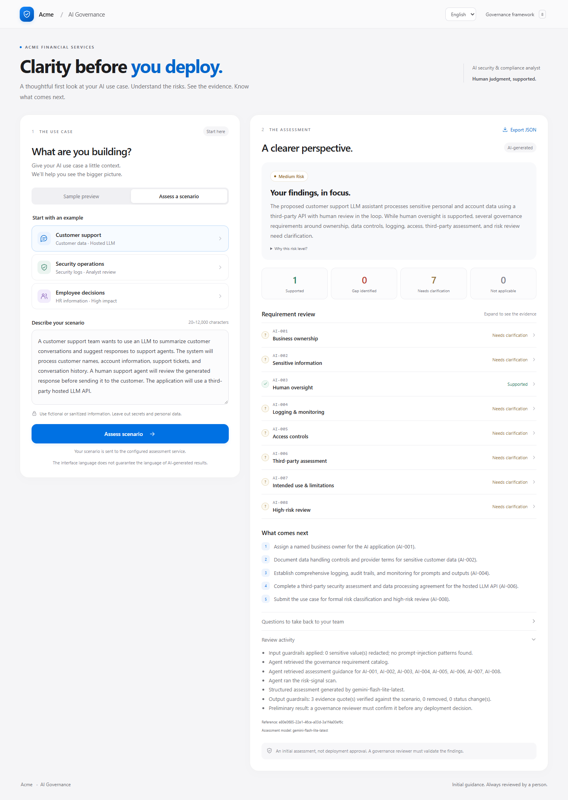
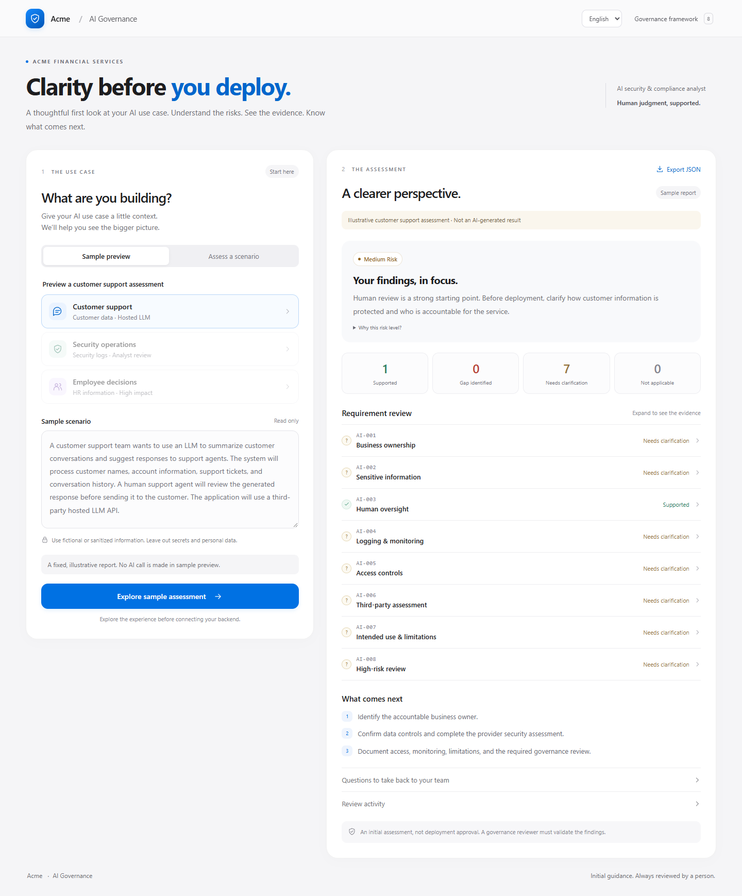
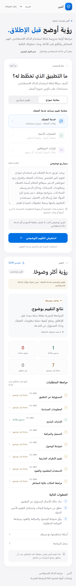

# AI Security & Compliance Analyst

A React and Python application for initial review of AI use cases against Acme Financial Services' eight internal governance requirements. Reports link each finding to scenario evidence, explain gaps and uncertainty, recommend actions, and require human review.

## Run locally

Prerequisites: Node.js 24 LTS and Python 3.11 or later.

Backend, in one terminal:

```powershell
cd backend
python -m venv .venv
.\.venv\Scripts\python.exe -m pip install -r requirements.txt
Copy-Item .env.example .env
# Set GEMINI_API_KEY in backend/.env; keep AI_PROVIDER=gemini. Never commit .env.
.\.venv\Scripts\python.exe -m uvicorn app.main:app --reload --port 8000
```

Frontend, in another terminal:

```powershell
cd frontend
npm ci
npm run dev
```

Open the local URL printed by Vite. The development server proxies `/api` to port 8000. No provider key belongs in the frontend.

## Use the application

- **Sample preview** shows a fixed, clearly labeled customer support report without calling AI.
- **Assess a scenario** accepts a sanitized scenario or one of the three examples and calls the Python backend. A valid provider key and working provider connection are required.
- Expand any requirement to inspect its evidence, explanation, and action. Review guardrail observations for redactions and output corrections. Export the report as JSON when needed.
- The header language selector switches between English and Arabic, including right-to-left layout. Authored examples and sample content are translated; live analysis follows the selected language, while evidence stays in the original scenario language. Switching languages offers reassessment of an existing live report.

## Assessment workflow

```text
Scenario -> input validation and redaction
         -> model-driven requirement/guidance lookup and risk scan
         -> structured AI findings
         -> evidence and policy guardrails
         -> audit trail and report
```

Each report covers AI-001 through AI-008: ownership, sensitive data, human oversight, logging, access controls, third-party assessment, intended use, and high-risk review. Missing descriptions are distinguished from explicit gaps. Evidence excerpts must be checked against the submitted scenario. Findings support a governance reviewer; they are not deployment approval.

## Verification

Frontend:

```powershell
cd frontend
npm test
npm run lint
npm run build
```

Backend:

```powershell
cd backend
.\.venv\Scripts\python.exe -m pip install -r requirements-dev.txt
.\.venv\Scripts\python.exe -m pytest -q
```

The backend test suite contains 64 deterministic tests, and the frontend suite contains 10 tests. The deterministic backend tests use a fake model. Passing them does not prove live model availability or quality. For the separate real-provider check, configure the backend key and run `python -m scripts.live_check` from `backend/`. This sends the three fictional scenarios to the configured provider.

## Screenshots and verification

Live Gemini assessments of all three fictional scenarios completed on 2026-10-23. A and B returned medium risk with human oversight supported; C returned high risk with an oversight gap. A real browser request also completed through React, Vite's proxy, FastAPI, the model tool-use loop, output guardrails, and the rendered report. Live results can vary; these observations are not a substitute for human review.

Desktop live AI assessment, with the actual review activity expanded:



[View the live employee-decision assessment with expanded oversight evidence](docs/screenshots/live-employee-review.png).

[View a live Arabic analysis with original English evidence](docs/screenshots/live-arabic-response.png). The Arabic narrative, recommendations, review trail, and evidence preservation were verified against a live response.

Illustrative sample preview on desktop (no model call):



Arabic sample preview on a 390-pixel mobile viewport (no model call):



Browser checks confirmed a one-line desktop title at 1440 pixels, no horizontal overflow at 390 pixels in Arabic, and no browser console errors during the assessment flow. Screenshots were captured from the running application; sample previews are explicitly labeled in the UI.

## Structure and notes

```text
frontend/src/components/   Focused UI components
frontend/src/i18n/         Locale registry, provider, and translation catalogs
frontend/src/lib/          API requests and response validation
frontend/tests/            API contract and localization tests
backend/app/              API, agent workflow, governance, and guardrails
backend/tests/            Deterministic backend tests
```

See [frontend setup](frontend/README.md), [backend setup and limitations](backend/README.md), [localization](docs/frontend-localization.md), and the [original API handoff](docs/backend-handoff.md). The backend code and its current schemas are the implementation reference; the handoff records the agreed initial contract.

Development is recorded through incremental commits. This is a local assessment prototype: it has no user authentication, relies on heuristic signal detection and redaction, and needs deployment controls before organizational use. Review the backend limitations before using real information. No repository changes should be made after final submission.
